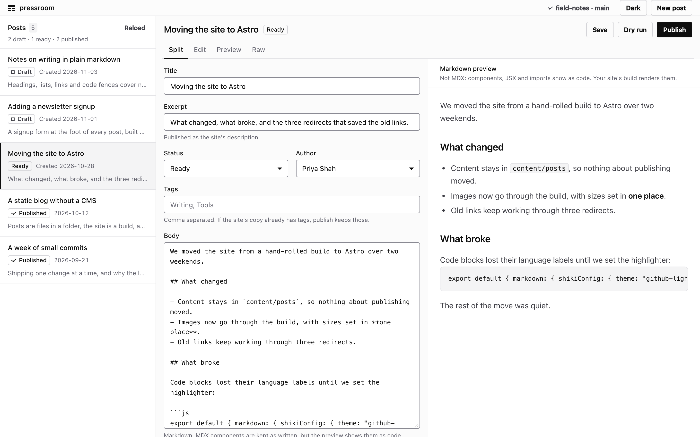

# pressroom

Write posts locally, preview them, and publish each one as a git commit that contains only that post's file.
Zero dependencies.

Docs and how to use it: https://playbook.excellent.so/pressroom



pressroom is for a blog that lives in a static site's git repo (Astro, Next.js, Eleventy, or anything that
builds Markdown or MDX files into pages). You write in a folder of `.mdx` files on your machine. When a post
is ready, `pressroom publish` writes it into your site's content folder, commits that one file, and pushes. If
your host builds on push, the post goes live.

## Install

Requires Node 20 or later and `git` on your PATH.

```sh
npm install -g @excellent-so/pressroom    # installs the pressroom command
npx @excellent-so/pressroom --help        # or run it without installing
npm install -D @excellent-so/pressroom    # or pin it in a project
```

To run it from a clone of this repo:

```sh
git clone https://github.com/excellent-so/pressroom.git
cd pressroom && npm link                  # puts pressroom on your PATH
```

## Quick start

```sh
pressroom init                    # writes pressroom.config.mjs here
# edit pressroom.config.mjs: set siteRepo to your site's git checkout
pressroom new "Hello, world"      # writes posts/hello-world.mdx, a draft
pressroom open                    # the viewer: edit, preview, publish
pressroom publish hello-world     # write it into the site repo, commit that one file, push
```

`pressroom doctor` checks the setup: git, the config file, whether `siteRepo` is a git repo, the content
folder, and how many posts are ready. Try `pressroom publish <slug> --dry-run` first to see the file it would
write.

Keep your posts folder outside the site repo (or gitignore it), so the drafts never end up in the site.

## With the Astro blog template

A site made with `npm create astro@latest -- --template blog` keeps its posts in `src/content/blog` and reads
the publish date from `pubDate`. Tell pressroom both in `pressroom.config.mjs`:

```js
export default {
  postsDir: "posts",
  siteRepo: "/Users/you/sites/my-astro-blog",
  contentDir: "src/content/blog",
  fields: { date: "pubDate" },
  branch: "main",
  push: true,
};
```

Then `pressroom import` brings the template's five posts (`.md` and `.mdx`) into your posts folder, and
publishing one you haven't changed makes no commit. A post the site already has keeps its file name, its
`heroImage` and the site's way of writing the date (`'Jul 08 2022'`). To give a new post a hero image, add
`heroImage: "../../assets/my-image.jpg"` to its frontmatter: keys pressroom doesn't know are kept in your post
file and published as they are.

Astro reads a date-only `pubDate` such as `2026-11-05` as midnight UTC, and the template's `FormattedDate`
shows it in the build machine's time zone. A build on a computer west of UTC shows the day before; a host
that builds in UTC shows the right day.

## With Eleventy

The Eleventy base blog (`github.com/11ty/eleventy-base-blog`) keeps its posts in `content/blog` and builds
Markdown, not MDX, so set `contentDir: "content/blog"` and `extension: ".md"`. A post's tags become Eleventy
collections, like the blog's own. `pressroom import` leaves out `fifthpost.md`, whose frontmatter is
JavaScript (`---js`), and says so.

## The viewer

`pressroom open` starts a local server and opens it in your browser (`pressroom serve` starts it without
opening). It has the post list with each post's status, an editor that saves to disk, a markdown preview or
the raw file beside it, and Publish and Dry run buttons that show you what git did. If no site is connected
yet, the viewer asks for the path, checks it is a git repo, and saves it to `pressroom.config.mjs`.

The viewer is light by default; the Dark button switches it, and the browser remembers the choice. It listens
on `127.0.0.1` only, port 4640 by default (`--port=N` or `$PORT`; if the port is busy it tries the next one,
up to 25 ports on). Requests that write files or publish are refused when they come from another site's page.

## Posts

Each post is one file in your posts folder (`./posts` by default), named `<slug>.mdx`:

```mdx
---
title: "Moving the site to Astro"
status: ready
excerpt: "What changed, what broke, and the three redirects that saved the old links."
author: "Sam Rivera"
tags:
  - "Tools"
created: "2026-10-28"
updated: "2026-10-30T14:12:00Z"
---

We moved the site from a hand-rolled build to Astro over two weekends.
```

| Status | Meaning |
|---|---|
| `draft` | Being written. `publish --all` skips it. |
| `ready` | Queued. `publish --all` publishes it. |
| `published` | On the site. `publish --all` publishes it again only if it changed. |

Once the site has the post, publishing sets it to `published` and gives it today's date (your computer's
calendar day) if it has none. A publish that fails leaves the post as it was.

The excerpt is published as the site's description. Leave it empty and publish uses the post's first
paragraph of prose instead (at most 160 characters), so the description always matches the post; a post
the site already has with no description is left without one. Any other
key you add (`heroImage`, `draft`, `layout`) stays in the file and is published as it is.

## What publish does

```
posts/<slug>.mdx  ->  <siteRepo>/<contentDir>/<slug>.mdx   (or the site's own <slug>.md, if it has one)
                      git add <contentDir>/<slug>.mdx
                      git commit -m "blog: publish <slug>" -- <contentDir>/<slug>.mdx
                      git push origin <branch>
```

- **One file per commit.** It stages only the file it wrote. Other changes in your site's working tree stay
  out of the commit.
- **No change, no commit.** If the site's copy already says the same thing (the same frontmatter values and
  body, however they're quoted or ordered), nothing is written, committed or pushed, so `publish --all` is
  safe to run again and again. The one exception: if an earlier publish committed the post but the push
  failed, publishing again pushes that commit.
- **No force-push.** If the remote has commits you don't have, the push fails, pressroom tells you to
  `git pull`, and shows git's message. Nothing on the remote is overwritten.
- **Checks first, then writes.** Before it writes anything, publish checks that git is installed, `siteRepo`
  is a git repo with the content folder in it, the checkout is on `branch`, there is a remote named `origin`
  (unless you don't push), and git has your name and email. It also refuses to overwrite the site's copy of
  the post if that file has changes you haven't committed. Each refusal is one sentence that says what to do.

The file it writes has the frontmatter a static site reads: `title`, `description` (the excerpt, or the start
of the body), `date`, `tags` and `author`, under the names in `fields`. When the site already has the post,
the keys pressroom doesn't own (`tags`, `author`, `heroImage` and any others) are kept from the site's copy;
the post's own fill in when the site's copy has none. To change one of those on a post the site already has,
edit it in the site repo. A post new to the site that names no author gets the default byline.

## Commands

| Command | What it does |
|---|---|
| `pressroom init` | Write a `pressroom.config.mjs` in the current folder (`--force` replaces one) |
| `pressroom new <title>` | Write a draft `<slug>.mdx` |
| `pressroom list` | Every post with its status, date, title and slug |
| `pressroom open` | Start the viewer and open it in your browser |
| `pressroom serve` | Start the viewer |
| `pressroom publish <slug>` | Write the post into the site repo, commit that file, push |
| `pressroom publish --all` | Publish every `ready` post, and every `published` post that changed |
| `pressroom import` | Copy the site's `.mdx` and `.md` posts into your posts folder (`--from=<dir>` for another folder) |
| `pressroom doctor` | Check git, the config, the site repo and the content folder; exits 1 if publishing can't work |
| `pressroom --version` | Print the version |
| `pressroom --help` | Print the commands and flags |

Publish takes `--dry-run` (print the file it would write and touch nothing) and `--no-push` (commit without
pushing). `open` and `serve` take `--port=N`. `import` matches posts by slug: a post already in your folder is
replaced by the site's version, and files that already match are left alone. A flag a command doesn't take
is an error, so a typo such as `--dryrun` never publishes for real.

Every command exits 0 when it did what you asked and 1 when it didn't.

## Configuration

`pressroom init` writes this, and pressroom finds it by looking in the current folder and then each folder
above it. `pressroom.config.js`, `.cjs` and `.json` work too.

```js
export default {
  postsDir: "posts",                       // your posts, relative to this file
  siteRepo: "/absolute/path/to/your-site", // your site's git checkout (the folder with .git in it)
  contentDir: "content/posts",             // where posts go inside the site repo
  branch: "main",                          // the branch publish pushes
  // fields: { date: "pubDate" },          // the frontmatter names your site reads, if not pressroom's
  // extension: ".mdx",                    // ".md" for a site that builds only Markdown
  // defaultAuthor: "Your Name",           // left unset: git config user.name
  // authors: ["Your Name", "A Co-author"],// more bylines for the viewer's Author menu
  push: true,                              // false: commit without pushing
};
```

- **`fields`** renames the keys publish writes and import reads: any of `title`, `description`, `date`, `tags`
  and `author`. `{ date: "pubDate" }` is the Astro blog template's.
- **`extension`** is the file extension for a post new to the site: `.mdx` (the default) or `.md`. A post the
  site already has keeps its own.
- **The byline** for new posts is `defaultAuthor`, or else your `git config user.name`, or else none (then
  posts have no `author` key). `pressroom doctor` shows which.

These settings also take a flag or an environment variable, which win over the file: `--site-repo` or
`PRESSROOM_SITE_REPO`, `--posts-dir` or `PRESSROOM_POSTS_DIR`, `--content-dir` or `PRESSROOM_CONTENT_DIR`,
`--branch` or `PRESSROOM_BRANCH`, and `--author` for the byline.

## What your site needs to accept

If your site checks frontmatter (an Astro content collection schema, a Next.js type), it needs to accept:

| Key (default name) | Value | When |
|---|---|---|
| `title` | a string | always |
| `description` | a string | when the post has an excerpt or prose to take one from (a post the site already has without one gets none) |
| `date` | `"YYYY-MM-DD"`, or the site's own date text for a post it already has | always |
| `tags` | a list of strings | when the post has tags |
| `author` | a string, or the site's own list | when there is a byline |

Plus any extra keys you add to a post. Astro's default `z.object()` ignores keys its schema doesn't name, so
`tags` and `author` are fine there; a `.strict()` schema would need them added.

## Where it writes, and what it sends

- **Your posts folder** (`postsDir`): `new`, `import` and the viewer write posts there, and publish marks a
  post `published`.
- **`pressroom.config.mjs`**: `init` writes it, and the viewer rewrites it when you connect a site.
- **Your site repo**: publish writes one post file into `contentDir`, commits it, and pushes.
- **Your browser** keeps the viewer's light or dark choice in its local storage.

Nothing else: no cache, no files in your home folder, no telemetry. The only network traffic is the
`git push` to your site's `origin`, made by your own git with your own credentials, and the viewer's server on
`127.0.0.1`. The viewer's fonts are inside its HTML file, so it loads nothing from outside, except an image
a post links to by its full URL.

## Limits

- **The preview is a markdown preview.** It draws headings, paragraphs, lists (nested items come out flat),
  block quotes, fenced code, rules, links, images, bold, italic and inline code. MDX components, JSX,
  `import` and `export` lines and HTML tags appear as labelled code when they start a line and as plain text
  inside one; tables appear as plain text. Your site's build is the real render.
- Images with paths on your site (`/images/a.png`, `../../assets/a.jpg`) don't load in the preview: it names
  them instead. Full URLs load.
- Your posts are `.mdx` files in the posts folder. On the site, publish writes `<slug>.mdx` (or `.md` with
  `extension: ".md"`), or the `.md` file the site already has; `import` reads `.mdx` and `.md`.
- Frontmatter is read as `key: value` lines and one-level lists. A site post whose frontmatter has a value
  over several lines (a nested map such as `author:` with `name:` under it, or `>-` text), or isn't YAML
  (`---js`, TOML's `+++`), is left out of `import`, and publish refuses to change it: edit those posts in the
  site repo.
- `import` reads the content folder itself, not the folders inside it.
- Publish rewrites a changed post's frontmatter in its own style: double quotes; `title`, `description` and
  the date first, then `tags`, the other keys in alphabetical order, and `author` last.
- Publish pushes `branch` to the remote named `origin`, and refuses while the site checkout is on another
  branch.
- Only post files are published. Images and other files go into the site repo the way you add them now.
- `import` replaces a post in your folder with the site's version, including edits you haven't published.
- The viewer is for one person on one machine. It has no accounts and no login.

## Uninstall

```sh
npm uninstall -g @excellent-so/pressroom
```

Your posts folder, `pressroom.config.mjs` and your site repo stay as they are; delete them yourself if you
want them gone.

## Development

```sh
npm test                  # the suite: offline, makes throwaway git repos in your temp folder
npm run test:standalone   # the CLI in a fresh HOME, a reduced PATH and a temp git repo
```

The viewer is one HTML file, `viewer/index.html`, built on `@excellent-so/kit` (MIT).
The kit's CSS sits between two markers in its `<style>`; to update it, run
`npx @excellent-so/kit sync viewer/index.html --no-compat --fonts`.

## License

MIT. See [LICENSE](LICENSE).
